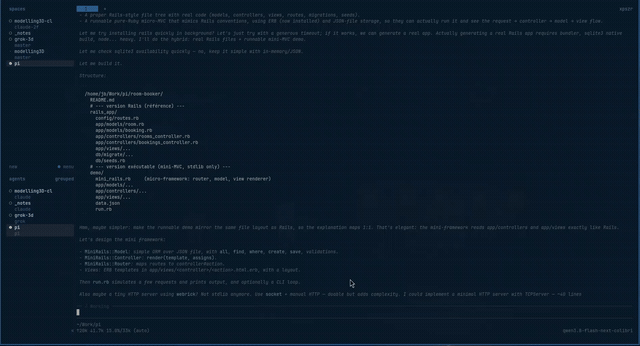

# Local models, and frontier models

French version: [README.fr.md](README.fr.md).

Recorded from a laptop. The agent talks to Colibri on a Windows PC. 12-second excerpt, starting at 0:24.



I have accepted it: agents are now part of the work chain. That has to happen carefully. I do not want a work chain that depends entirely on hosted frontier models.

For local inference, the wall is memory. Fitting the whole model into GPU RAM, whose prices have reached the stars.

Colibri, an open-source engine written in C, shows another way. It does not use the GPU exclusively: the card keeps what is used often, system RAM keeps what must stay close, and the SSD keeps the rest, read on demand. The balance point comes down. You can use the machine you already have.

On my desktop — an RTX 3090 (24 GB), 64 GB of RAM, an NVMe SSD — a 68 GB compressed model does not fit on the card. Twice too big. With Colibri, a newcomer shaking up the field, it runs at about 35 token/s, and it writes correct Ruby, tests included.

How? These models are Mixture of Experts: at each token, only part of the parameters work. Colibri therefore does not load everything onto the card. It keeps the shared part in memory. Experts stay on the SSD, and it fetches the ones it needs on the fly. The card keeps the hottest ones. RAM takes the rest of what must stay close.

Pushed to the end, the same principle holds Mistral Large 4, "Le Chonk": 1,000 billion parameters, 233 GB even when compressed to the extreme. There, RAM is not enough. The SSD becomes the memory. 0.8 token/s, 16 seconds before the answer starts. At this stage it is an experiment, not a tool. That it is possible at all is already a feat.

If the local workstation is still here in the future, I think the work chain will be a mix of local and cloud models. The reasons are many, and they do not motivate the same people. Developers want to use their tools without a cap. Organizations want to control cost. Both need confidentiality. Mix and isolation are the direction Microsoft is taking. GitHub Copilot will choose, task by task, a local model or a cloud model. On RTX Spark Windows PCs, such as the Surface Laptop Ultra, code can run on the machine. The agent's commands go through MXC, a sandbox: files, network, credentials, without opening the whole machine.

Colibri is a very good symptom of this pressure. The race for RAM on local machines hits the price wall. On the French Apple Store, 1 November: a Mac Studio M5 Ultra (36-core CPU, 80-core GPU) is €12,429 with 256 GB, and €25,079 with 512 GB.

The point is to find the right balance. This kind of tool lets us do that, without stopping at graphics memory.

I share discoveries and field notes here, openly, without preaching about the use of AI agents in my fields.

Learn, do, share.

## Sources

- Colibri (Apache 2.0): https://github.com/JustVugg/colibri
- Mistral Large 4: https://mistral.ai/news/mistral-large-4-oss/
- Compressed Chonk weights (1-bit GGUF, Unsloth): https://unsloth.ai/docs/models/mistral-large-4
- Compressed Qwen3.8-Flash-Next (IQ2_XS): https://huggingface.co/ISTA-DASLab/Qwen3.8-Flash-Next-GSQ-RCO-GGUF
- The same idea, with no graphics card (Marco Franzon, 4 Raspberry Pi 5): https://x.com/mfranz_on/status/2115884818734911795
- Microsoft, local models and sandboxed tools: https://commandline.microsoft.com/local-models-sandboxed-tools-github-windows/
- MXC: https://github.com/microsoft/mxc
- Mac Studio prices: French Apple Store configurator, 1 November 2026, 36-core CPU / 80-core GPU. €12,429 at 256 GB. 512 GB shown as + €12,650, so €25,079.

## Install

If you use a coding assistant, it can do the install. Ask it:

> Install Colibri on this Windows machine by following https://raw.githubusercontent.com/jbheren/colibri-tour/main/skills/colibri-tour/SKILL.md

Install notes, not a fork of Colibri. Two cases:

- a machine like the reference tower (RTX 3090 24 GB, 64 GB of RAM, NVMe SSD): Qwen3.8-Flash-Next;
- an ordinary PC with 16 GB of RAM, graphics card optional: Qwen3-Coder-30B-A3B.

The 16 GB choice comes from the Colibri catalog ([README](https://github.com/JustVugg/colibri#which-model-for-my-machine), read on 1 November 2026): below 8 GB it does not start, from 18 GB it runs as measured. At 16 GB it starts, and some experts may stay on disk. Do not install Qwen3.8-Flash-Next on 16 GB: the catalog asks for 24 GB before it starts.

Do not commit an API key. The server refuses a network bind without one.

Colibri does not need the whole model on the GPU. The card keeps hot experts, RAM keeps the shared layers (or, for Qwen, the dense layers), and the SSD keeps the cold experts.

## Install, both cases

1. Windows release from https://github.com/JustVugg/colibri/releases: `colibri-v*-windows-x86_64.zip` (and `...-cuda.zip` on top if there is an Nvidia card). Check `SHA256SUMS.txt`. The launcher is `coli.cmd`.
2. Before any model download, `coli.cmd setup --list`, and keep only what fits.
3. Next time, `coli.cmd serve --model <folder>`. `coli.cmd status` and `coli.cmd stop`.

## 16 GB PC — Qwen3-Coder-30B-A3B

Code and tool calls, no thinking. Id: `qwen3-coder-30b`. Download 19 GB. Colibri's published CPU measurement, every expert in RAM: 8.5 to 9.6 token/s. Do not expect that speed at 16 GB.

```bat
coli.cmd setup --model qwen3-coder-30b
```

A graphics card is optional. Vulkan, including an integrated GPU, is supported for this model. CUDA is not required. Qwen3.6-35B-A3B (`qwen36-35b`, 23 GB, 10 / 20 GB of RAM) is the default only if `--list` marks it as running as measured. On 16 GB, it does not.

## Mistral Large 4 ("Le Chonk") — an experiment

233 GB, 1-bit quantization (Unsloth `UD-IQ1_S`). It fits neither in the GPU nor in RAM.

```powershell
hf download unsloth/Mistral-Large-4-1T-A52B-GGUF --include "UD-IQ1_S/*" --local-dir C:\models\ml4
coli.cmd import C:\models\ml4\UD-IQ1_S\Mistral-Large-4-1T-A52B-UD-IQ1_S-00001-of-00006.gguf
```

Import is link mode: no second copy.

GPU: Colibri picks Vulkan for this GGUF, then fails (`COLI_GPU(S) requires COLI_CUDA=1`). Force CUDA.

```powershell
$env:COLI_VULKAN = "0"
$env:COLI_CUDA = "1"
coli.cmd serve --ctx 32768 --vram 16 --host 0.0.0.0 --api-key $env:COLI_API_KEY --model C:\models\ml4\UD-IQ1_S\Mistral-Large-4-1T-A52B-UD-IQ1_S.colibri
```

- `--vram 16`: fewer hot experts (734 instead of 976). Without it, a 32,768-token context was refused once the usage file grew (56.7 GB planned for 51.4 available).
- `--ctx 65536` refuses to start (about 61 GB planned). 40,960 starts, with no margin.
- One engine at a time: two instances do not fit in RAM.
- `coli chat` without a server sends the GLM dialogue format. The model then introduces itself as Qwen. Go through `coli serve`, which applies the Mistral template.

Measurement (CUDA, 36 prompt tokens, 64 generated, no thinking): 0.77 token/s, 16.4 s to read the prompt, 41.6 GB of RAM. Not a work tool.

## Qwen3.8-Flash-Next — the useful case

68 GB, `IQ2_XS` (ISTA-DASLab). Too big for the 3090 alone. Fits on card plus RAM.

```powershell
hf download ISTA-DASLab/Qwen3.8-Flash-Next-GSQ-RCO-GGUF --include "IQ2_XS/*" --local-dir C:\models\q38
coli.cmd import C:\models\q38\IQ2_XS\Qwen3.8-Flash-Next-GSQ-RCO-IQ2_XS-00001-of-00002.gguf
$env:COLI_VULKAN = "1"
coli.cmd serve --ctx 32768 --host 0.0.0.0 --api-key $env:COLI_API_KEY --model C:\models\q38\IQ2_XS\Qwen3.8-Flash-Next-GSQ-RCO-IQ2_XS.colibri
```

Without `COLI_VULKAN=1`, everything stays on the CPU (8 token/s). With Vulkan: about 35 token/s, request included, on a Ruby task of about 500 tokens (31 October).

Turn thinking off in the API call (`enable_thinking: false`), or the token budget goes into reasoning and no code is emitted.

Calling from another machine on the LAN: send `Host: 127.0.0.1`, or start the server with `--allowed-host` for the IP. By default Colibri rejects the Host header of the LAN address.

## Sources

- https://github.com/JustVugg/colibri
- https://mistral.ai/news/mistral-large-4-oss/
- https://unsloth.ai/docs/models/mistral-large-4
- https://huggingface.co/ISTA-DASLab/Qwen3.8-Flash-Next-GSQ-RCO-GGUF
